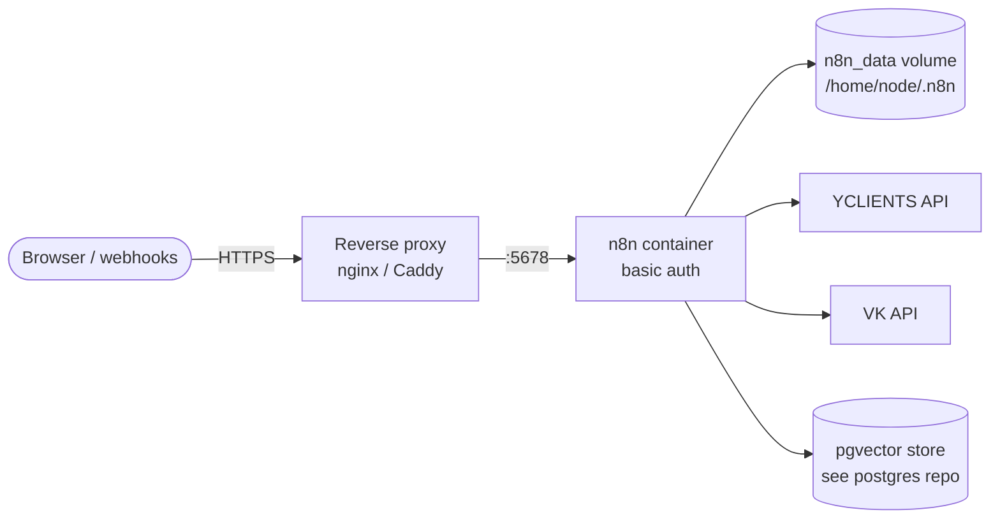

# n8n — self-hosted automation server

A Docker Compose setup for running a self-hosted [n8n](https://n8n.io) instance on your own domain behind HTTPS, with basic auth, persistent data and environment-based secrets for integrations (YCLIENTS, VK).

## Topology



## Run

```bash
cp .env.example .env     # basic-auth credentials, domain, integration tokens
docker compose up -d
```

| Variable | Description |
|---|---|
| `N8N_BASIC_AUTH_USER`, `N8N_BASIC_AUTH_PASSWORD` | UI credentials |
| `N8N_HOST` | public domain; also used for `WEBHOOK_URL` |
| `YCLIENTS_BEARER`, `YCLIENTS_USER` | YCLIENTS API tokens |
| `VK_TEST_USER` | VK API token |

n8n listens on port `5678`; put it behind a reverse proxy for HTTPS on your domain.

## Restart without losing data

```bash
docker compose down
docker compose up -d
```

Workflow data lives in the `n8n_data` volume, so containers can be recreated freely. See [`DEPLOYMENT.md`](DEPLOYMENT.md) for the full procedure.

Related: [postgres](https://github.com/Fortuneq/postgres) — pgvector store used by the n8n RAG agent.
